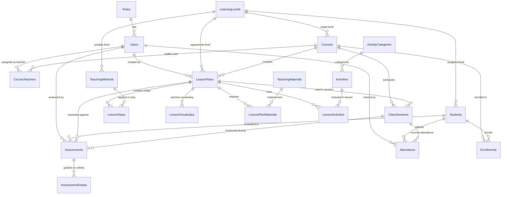

# LittleTalk – Kids English Speaking Teaching Management System

[](https://dotnet.microsoft.com/)
[](https://dotnet.microsoft.com/apps/aspnet/web-apps/blazor)
[](https://mudblazor.com/)
[](https://www.microsoft.com/sql-server/)
[]()

> **LittleTalk** is a real-world, production-ready Kids English Speaking Teaching Management System designed to empower ESL/EFL educators in preparing structured lesson plans, applying active teaching methodologies (Total Physical Response, Phonics, Choral Repetition, Role-Play), orchestrating speaking activities, managing student cohorts, tracking attendance, and evaluating oral language proficiency across six core speaking dimensions.

---

## 1. System Architecture

LittleTalk is architected as an enterprise multi-tier solution using **Feature-Based Vertical Slice Architecture** on the backend and **MudBlazor Interactive Server** on the frontend, built with a strict **Database-First** lifecycle against Microsoft SQL Server.

```
                              ┌──────────────────────────────────────────────────┐
                              │            LittleTalk.Client (Blazor)            │
                              │  • MudBlazor 9.9.0 Pastel Child-Friendly Theme   │
                              │  • CustomAuthenticationStateProvider + Storage   │
                              │  • Typed ApiClient & Delegating HTTP Handler     │
                              └────────────────────────┬─────────────────────────┘
                                                       │ HTTPS (JSON / REST API)
                                                       ▼
                              ┌──────────────────────────────────────────────────┐
                              │              LittleTalk.Api (Web API)            │
                              │  • Feature Slice Controllers & Endpoints         │
                              │  • Global Exception & Security Headers Middleware│
                              │  • JWT Bearer Authentication & RBAC Policies     │
                              │  • Swagger / OpenAPI with Bearer Auth            │
                              │  • Health Check Endpoints (/health)              │
                              └───────────┬──────────────────────────┬───────────┘
                                          │                          │
                                          ▼                          ▼
┌──────────────────────────────────────────────────┐   ┌──────────────────────────────────────────────────┐
│          LittleTalk.Application (Logic)          │   │        LittleTalk.Infrastructure (Data)          │
│  • Feature DTOs & Service Contracts              │   │  • Scaffolded EF Core LittleTalkDbContext        │
│  • FluentValidation Rules & Validators           │   │  • 20 Database Entities & Analytical Views       │
│  • Score Calculation & Grade Tier Rules          │   │  • PBKDF2 Password Hashing & JWT Token Service   │
└──────────────────────────────────────────────────┘   └──────────────────────────┬───────────────────────┘
                                                                                  │ EF Core (T-SQL)
                                                                                  ▼
                                                       ┌──────────────────────────────────────────────────┐
                                                       │       Microsoft SQL Server (LittleTalkDb)        │
                                                       │  • 20 Normalized Tables & Foreign Keys           │
                                                       │  • Filtered Unique Indexes & Business Triggers   │
                                                       │  • Analytical View vw_StudentAssessmentSummaries │
                                                       └──────────────────────────────────────────────────┘
```

---

## 2. Technology Stack

### Backend
- **Framework**: C# / ASP.NET Core 8.0 Web API
- **Data Access**: Entity Framework Core 8.0 (Strict Database-First workflow; no Code-First migrations)
- **Database**: Microsoft SQL Server 2022+ (`LittleTalkDb`)
- **Authentication**: JWT Bearer Tokens with ASP.NET Core Identity PBKDF2 password hashing (`IPasswordHasher<User>`)
- **Authorization**: Role-Based Access Control (`Admin`, `Teacher`, extensible to `Parent`)
- **Validation**: FluentValidation with automatic dependency injection and fail-fast pipeline
- **API Documentation**: Swagger / Swashbuckle OpenAPI with Bearer authentication
- **Monitoring & Security**: `/health` endpoint, standard security response headers (`X-Content-Type-Options`, `X-Frame-Options`, `Referrer-Policy`)

### Frontend
- **Framework**: Blazor Web App (.NET 8 Interactive Server Render Mode)
- **UI Component Library**: MudBlazor 9.9.0
- **Visual Design**: Soft-pastel children's educational theme:
  - Primary (Sky Blue `#4A90E2`), Secondary (Warm Coral `#FF6B6B`), Tertiary (Mint Green `#2EC4B6`), Success (Grass Green `#38A169`), Warning (Sunny Peach `#ED8936`)
  - Typography: Rounded headings (`Fredoka`) and legible body copy (`Quicksand`)
- **State Management**: `CustomAuthenticationStateProvider` integrated with browser `localStorage` and `TokenAuthenticationHandler`

### Automated Testing Suite
- **Test Framework**: xUnit 2.9.3 & `Microsoft.NET.Test.Sdk`
- **Integration Testing**: `Microsoft.AspNetCore.Mvc.Testing` (`WebApplicationFactory<Program>`)
- **Validation Testing**: `FluentValidation.TestHelper`
- **Coverage**: Password hashing uniqueness/tampering, JWT claims generation, FluentValidation bounds, overall assessment mathematical averaging, and full-stack authenticated API round-trips (**23/23 tests passing**).

---

## 3. Database Design & Schema (20 Tables)

The database follows third normal form (3NF), enforcing business integrity at the database engine level via filtered unique indexes and multi-row triggers.



### Key Database Integrity Features
1. **Enrollment History**: Filtered unique index `UX_Enrollments_Course_Student_Active` on `(CourseId, StudentId)` where `Status = 'Enrolled'` guarantees only one active enrollment while preserving historical records.
2. **Primary Teacher Rule**: Filtered unique index `UX_CourseTeachers_Primary` on `(CourseId)` where `RoleInCourse = 'Primary' AND IsActive = 1` enforces that a course can have at most one active lead teacher.
3. **Attendance Verification**: Database trigger `TR_Attendance_ValidateEnrollment` validates multi-row inserts and updates to ensure students are actively enrolled in the session's course before attendance can be recorded.
4. **Assessment Criteria**: `AssessmentDetails` check constraint `CK_AssessmentDetails_CriterionName` validates that ratings belong strictly to the 6 core speaking dimensions:
   - `Pronunciation`
   - `Vocabulary`
   - `Fluency`
   - `Sentence Formation`
   - `Confidence`
   - `Listening and Responding`
5. **Score Bounds**: Check constraint `CK_Assessments_OverallScore` guarantees that overall scores fall strictly between `1.00` and `5.00`.
6. **Child Privacy & Minimal PII**: Students use system-generated codes (`STU-000001`). No sensitive government IDs or addresses are collected. Soft-deletion flags (`IsActive`) preserve all evaluation history.

---

## 4. Main Modules & Features

### 1. Authentication & Role-Based Authorization
- Secure JWT Bearer authentication with configurable expiration.
- Custom authentication state provider with automatic session restoration and token cleanup on expiry.
- 1-Click quick login switcher on the login page for rapid role testing (`Admin`, `Teacher Sarah`, `Teacher David`).

### 2. Modern Teacher & Admin Dashboard
- **Teacher View**: Assigned active courses, enrolled students, upcoming scheduled classes, quick "Take Attendance" shortcuts, and recent speaking evaluations.
- **Admin View**: System-wide statistics (total students, active courses, lesson plans, total evaluations), student distribution across learning levels, and platform activity logs.

### 3. Student Management
- Student roster with search by name/code and filtering by learning level.
- Profile dialog with guardian contact details and teacher private notes.
- Detailed student modal displaying enrollment history and speaking progress summaries.

### 4. Course & Staffing Management
- Course management with duration, max capacity, and active status toggles.
- Course staffing dialog: Assign primary lead teachers and assistant teachers.
- Course enrollment dialog: Enroll active students, view capacity, and withdraw students while maintaining historical logs.

### 5. Lesson Plan Management (Core Feature)
- Curriculum builder supporting detailed lesson planning:
  - Header: Course, Topic, Level, Age Group, Duration, Learning Objectives.
  - Multi-step ordering: Add, reorder (Move Up / Down), and edit classroom steps.
  - Pedagogical steps: Step Name, Duration, Teaching Method (TPR, Phonics, etc.), Detailed Teacher Instructions, **Teacher Script** (what the teacher says), and **Expected Student Response** (what children should say).
  - Target Vocabulary: Word list with definitions, phonetics, and example sentences.
- **1-Click Lesson Plan Cloning**: Clone any master lesson plan into another course or level.
- **Printable Classroom Sheet**: Clean printable view formatted for A4 classroom clipboards with browser `window.print()` integration.

### 6. Teaching Methods Library
- Built-in ESL methodologies library:
  - Total Physical Response (TPR)
  - Phonics & Sound Blending
  - Choral Repetition
  - Call and Response
  - Role-Play & Dialogues
  - Gamified Speaking
- Outlines teacher instructions, suitable age groups, and required materials.

### 7. Speaking Activities Catalog
- Reusable speaking games and drills categorized by:
  - Warm-up & Icebreakers
  - Phonics Games
  - Vocabulary Drills
  - Sentence Building & Conversations
  - Storytelling & Role-Play
- Filter by category, target age group, and duration.

### 8. Attendance & Class Sessions
- Schedule class sessions linked to courses and optional lesson plans.
- Attendance dialog with **1-Click "Mark All Present"** bulk action.
- Individual attendance status toggles (`Present`, `Absent`, `Late`, `Excused`) with remarks per child.

### 9. Speaking Assessments & Skill Radar
- Conduct speaking evaluations linked to sessions and lesson plans.
- Interactive **1 to 5 star rating widgets** across the 6 core criteria.
- Real-time mathematical average score computation and feedback note fields (Strengths, Areas for Improvement, General Feedback).
- Enforces evaluation of all 6 criteria before an assessment can be finalized.

### 10. Student Progress Reports & Parent Dossiers
- Comprehensive student report card:
  - Overall speaking proficiency grade tier (`Outstanding`, `Proficient`, `Developing`, `Emerging`).
  - Attendance rate percentage and session breakdown.
  - Visual breakdown bars across all 6 speaking skills.
  - Historical evaluation timeline.
  - Printable Parent Progress Report view.

---

## 5. Seeded Test Credentials

The database comes pre-seeded with real-world ESL data and test accounts:

| Role | Username | Password | Email | Assigned Courses |
| :--- | :--- | :--- | :--- | :--- |
| **System Admin** | `admin` | `Admin@123` | `admin@littletalk.edu` | System-wide administrator |
| **Lead Teacher** | `teacher.sarah` | `Teacher@123` | `sarah@littletalk.edu` | *English for Kids*, *Storytelling* |
| **ESL Teacher** | `teacher.david` | `Teacher@123` | `david@littletalk.edu` | *Daily English Speaking*, *Pronunciation Practice* |

---

## 6. Getting Started & Running Locally

### Prerequisites
1. **.NET 8.0 SDK** (or .NET 10 with .NET 8 targeting pack)
2. **Microsoft SQL Server** (LocalDB, SQL Express, or SQL Server 2022+ default instance `.`)
3. **SQL Server Management Studio (SSMS)** or Azure Data Studio

### Step 1: Initialize the Database
1. Open SSMS or your preferred SQL tool and connect to `.` (localhost).
2. Execute the initialization script:
   [`database/LittleTalk_Db_Init.sql`](file:///d:/LittleTalk/database/LittleTalk_Db_Init.sql)
3. This creates `LittleTalkDb`, scaffolds all 20 tables, indexes, triggers, views, and seeds initial roles, users, courses, students, lesson plans, and assessments.

### Step 2: Verify Connection Strings
Confirm that `DefaultConnection` in both API configuration files points to your SQL Server:
- [`src/LittleTalk.Api/appsettings.json`](file:///d:/LittleTalk/src/LittleTalk.Api/appsettings.json)
- [`src/LittleTalk.Api/appsettings.Development.json`](file:///d:/LittleTalk/src/LittleTalk.Api/appsettings.Development.json)

Default connection string:
```json
"ConnectionStrings": {
  "DefaultConnection": "Server=.;Database=LittleTalkDb;Trusted_Connection=True;TrustServerCertificate=True;MultipleActiveResultSets=true"
}
```

### Step 3: Run from Visual Studio 2022
1. Open [`LittleTalk.sln`](file:///d:/LittleTalk/LittleTalk.sln) in Visual Studio.
2. The multi-project launch profile `LittleTalk.slnLaunch.user` will launch both projects automatically:
   - `LittleTalk.Api` -> `http://localhost:5131/swagger`
   - `LittleTalk.Client` -> `http://localhost:5107`
3. Press **F5** or **Ctrl+F5**.

### Step 4: Run from Terminal / CLI
Open two separate terminal windows:

**Terminal 1 (Backend API):**
```powershell
dotnet run --project d:\LittleTalk\src\LittleTalk.Api\LittleTalk.Api.csproj
```
*API Swagger UI: [http://localhost:5131/swagger](http://localhost:5131/swagger)*  
*Health Check: [http://localhost:5131/health](http://localhost:5131/health)*

**Terminal 2 (Blazor Web App):**
```powershell
dotnet run --project d:\LittleTalk\src\LittleTalk.Client\LittleTalk.Client.csproj
```
*Blazor Web App: [http://localhost:5107](http://localhost:5107)*

---

## 7. Running the Automated Test Suite

To run all unit and integration tests:

```powershell
dotnet test d:\LittleTalk\tests\LittleTalk.Tests\LittleTalk.Tests.csproj -v normal
```

### Test Suite Summary
- **Total Tests**: 23
- **Passed**: 23 (100%)
- **Test Categories**:
  - `PasswordHasherTests`: PBKDF2 hashing, random salt uniqueness, correct/incorrect verification, malformed hash safety.
  - `JwtTokenServiceTests`: Token structure, claims issuance (`sub`, `unique_name`, `role`, `fullName`), expiry validation.
  - `ValidationTests`: FluentValidation rules for student age limits (2–18 yrs), required names, assessment score bounds (1–5), and mandatory 6-criteria finalization.
  - `AssessmentScoringTests`: Decimal average precision, ceiling/floor boundary scores.
  - `ApiIntegrationTests`: Full-stack WebApplicationFactory tests covering health checks, security headers, unauthenticated 401 challenge, admin login, and authenticated queries for courses, students, lesson plans, and teaching methods.

---

## 8. Solution Structure

```
d:\LittleTalk\
├── database\
│   └── LittleTalk_Db_Init.sql              # Master DDL script (20 tables, triggers, seeds)
├── src\
│   ├── LittleTalk.Infrastructure\          # Scaffolding & Data Access
│   │   ├── Authentication\                 # PBKDF2 PasswordHasher & JwtTokenService
│   │   ├── Data\
│   │   │   ├── Entities\                   # 20 Scaffolded EF Core entity classes
│   │   │   └── LittleTalkDbContext.cs      # EF Core DbContext with constraints & relationships
│   │   └── Services\                       # CurrentUserService
│   ├── LittleTalk.Application\             # Business Logic & Core Contracts
│   │   ├── Common\                         # Exceptions, Models (ApiResponse, PagedResult)
│   │   └── Features\                       # Vertical Slices
│   │       ├── Activities\                 # DTOs, Services, Validators
│   │       ├── Assessments\                # 6 Criteria evaluation logic & averaging
│   │       ├── Attendance\                 # Session scheduling & bulk attendance
│   │       ├── Auth\                       # Login requests & responses
│   │       ├── Courses\                    # Course catalog, staffing & enrollments
│   │       ├── Dashboard\                  # Role-based KPI queries
│   │       ├── LessonPlans\                # Curriculum steps, scripts & cloning
│   │       ├── Reports\                    # Progress dossier & skill radar data
│   │       ├── Students\                   # Child profiles & learning history
│   │       └── TeachingMethods\            # ESL methods library
│   ├── LittleTalk.Api\                     # ASP.NET Core Web API
│   │   ├── Extensions\                     # Swagger & DI Extensions
│   │   ├── Features\                       # Feature slice API controllers
│   │   ├── Middleware\                     # Global exception & security headers middleware
│   │   └── Program.cs                      # Pipeline configuration, health checks, Swagger
│   └── LittleTalk.Client\                  # Blazor Web App (MudBlazor UI)
│       ├── Components\
│       │   ├── Dialogs\                    # Modal dialogs for all CRUD operations
│       │   ├── Layout\                     # MainLayout with pastel theme, NavMenu, AppBar
│       │   └── Pages\                      # Feature pages (Dashboard, Students, LessonPlans...)
│       ├── Properties\
│       │   └── launchSettings.json         # Configured for http://localhost:5107
│       ├── Services\                       # CustomAuthStateProvider, ApiClient, LocalStorage
│       └── Program.cs                      # MudBlazor services & HttpClient configuration
└── tests\
    └── LittleTalk.Tests\                   # Automated Test Suite (xUnit + WebApplicationFactory)
        ├── IntegrationTests\               # End-to-end API tests
        └── UnitTests\                      # Unit tests for Hash, JWT, Scoring, Validation
```

---

## 9. License & Usage

Developed as an enterprise educational management solution for English language learning academies and ESL educators. All rights reserved.
