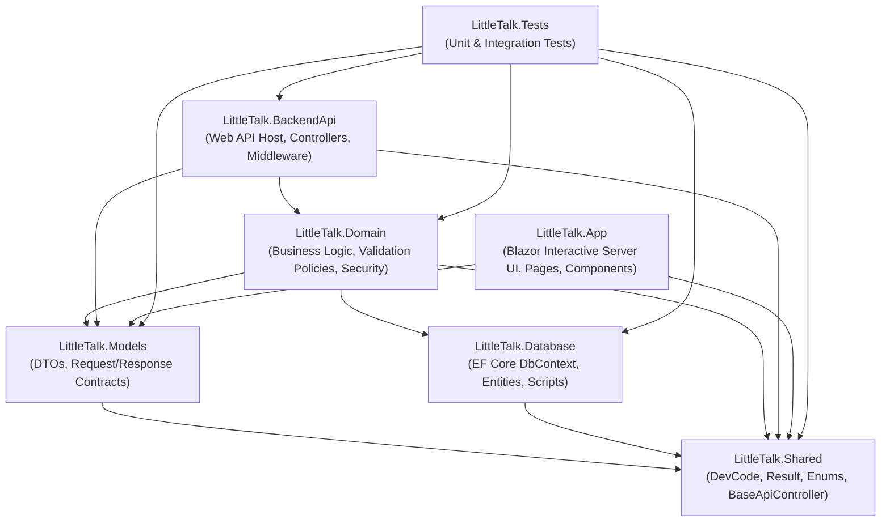

# Architectural Model & Project Schema Mapping

## Solution Graph & Project Dependencies



---

## Directory Schema Comparison & Migration Map

| Current LittleTalk Path | Target Aligned Path (GTB Model) | Project Responsibility |
|---|---|---|
| `src/LittleTalk.Api/` | `LittleTalk.BackendApi/` | Web API HTTP entry point, controllers, Serilog logging, OpenAPI/Swagger |
| `src/LittleTalk.Client/` | `LittleTalk.App/` | Blazor UI host, MudBlazor components, client API clients, auth state |
| `src/LittleTalk.Application/` | `LittleTalk.Domain/` | Authoritative domain business rules, validation policies, security/token services |
| `src/LittleTalk.Model/` | `LittleTalk.Models/` | Transport contracts, feature request/response models |
| `src/LittleTalk.Infrastructure/Data/` + `database/` | `LittleTalk.Database/` | EF Core DbContext, Entities, SQL initialization script (`Scripts/`), `db.md` |
| *New Extraction* (from `LittleTalk.Model/Common` & `LittleTalk.Api/Common`) | `LittleTalk.Shared/` | Shared utilities (`DevCode.cs`), `Result<T>`, `ResponseDefinition`, base controller |
| `tests/LittleTalk.Tests/` | `LittleTalk.Tests/` | Unit test suite and integration test suite |
| `appsettings.json` (root) | `Config/appsettings.json` | Centralized solution runtime configuration |
| *New* | `Config/custom-settings-dev.json` | Development-specific custom settings |
| *New* | `docs/architecture.md` | Enterprise architecture document and responsibility matrix |
| `.specify/` | `.specify/` | Spec-Kit scripts, constitution, and templates |
| `specs/` | `specs/` | Spec-Driven Development feature specifications |

---

## Target Project Directory Trees

### 1. `LittleTalk.Shared`
```text
LittleTalk.Shared/
├── LittleTalk.Shared.csproj
├── DevCode.cs
├── Result.cs
├── ResultType.cs
├── ResponseDefinition.cs
└── Common/
    └── BaseApiController.cs
```

### 2. `LittleTalk.Models`
```text
LittleTalk.Models/
├── LittleTalk.Models.csproj
└── Features/
    ├── Activities/
    ├── Assessments/
    ├── Attendance/
    ├── Auth/
    ├── Courses/
    ├── Dashboard/
    ├── LessonPlans/
    ├── Reports/
    ├── Students/
    └── TeachingMethods/
```

### 3. `LittleTalk.Database`
```text
LittleTalk.Database/
├── LittleTalk.Database.csproj
├── LittleTalkDbContext.cs
├── db.md
├── Entities/
│   ├── Activity.cs
│   ├── Assessment.cs
│   ├── Attendance.cs
│   ├── Course.cs
│   ├── Enrollment.cs
│   ├── LessonPlan.cs
│   ├── Student.cs
│   ├── User.cs
│   └── ... (all 20 entities)
└── Scripts/
    └── LittleTalk_Db_Init.sql
```

### 4. `LittleTalk.Domain`
```text
LittleTalk.Domain/
├── LittleTalk.Domain.csproj
├── DependencyInjection.cs
├── Features/
│   ├── Activities/
│   ├── Assessments/
│   ├── Attendance/
│   ├── Auth/
│   ├── Courses/
│   ├── Dashboard/
│   ├── LessonPlans/
│   ├── Reports/
│   ├── Students/
│   └── TeachingMethods/
├── Security/
│   ├── IJwtTokenService.cs
│   ├── JwtTokenService.cs
│   ├── IPasswordHashService.cs
│   └── PasswordHashService.cs
└── Services/
    ├── ICurrentUserService.cs
    └── CurrentUserService.cs
```

### 5. `LittleTalk.BackendApi`
```text
LittleTalk.BackendApi/
├── LittleTalk.BackendApi.csproj
├── Program.cs
├── LittleTalk.BackendApi.http
├── Properties/
│   └── launchSettings.json
├── Extensions/
│   └── SwaggerExtensions.cs
├── Middleware/
│   └── GlobalExceptionMiddleware.cs
└── Features/
    ├── Activities/
    ├── Assessments/
    ├── Attendance/
    ├── Auth/
    ├── Courses/
    ├── Dashboard/
    ├── LessonPlans/
    ├── Reports/
    ├── Students/
    └── TeachingMethods/
```

### 6. `LittleTalk.App`
```text
LittleTalk.App/
├── LittleTalk.App.csproj
├── Program.cs
├── Properties/
│   └── launchSettings.json
├── Components/
│   ├── App.razor
│   ├── Routes.razor
│   ├── _Imports.razor
│   ├── Dialogs/
│   ├── Layout/
│   └── Pages/
├── Services/
│   ├── CustomAuthenticationStateProvider.cs
│   ├── LocalStorageService.cs
│   ├── TokenAuthenticationHandler.cs
│   └── Features/
└── wwwroot/
```

### 7. `LittleTalk.Tests`
```text
LittleTalk.Tests/
├── LittleTalk.Tests.csproj
├── UnitTests/
└── IntegrationTests/
```
